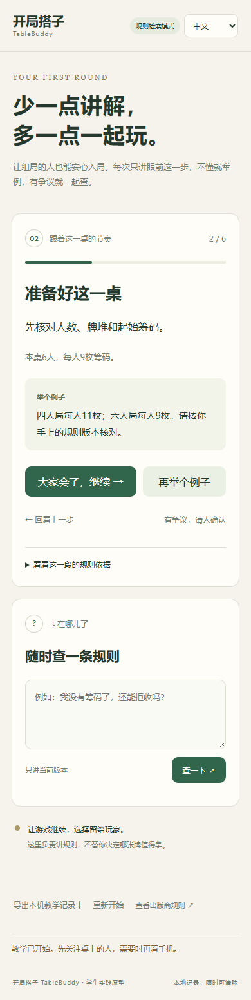
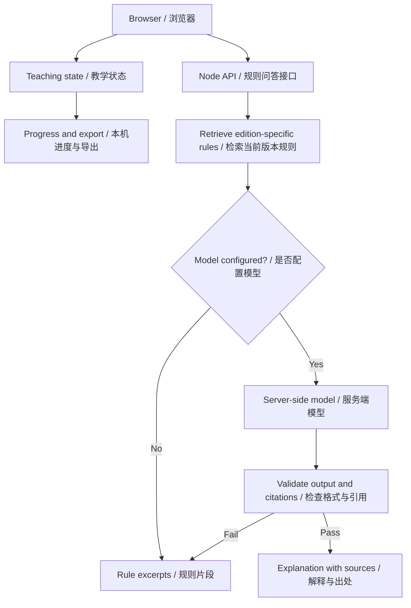
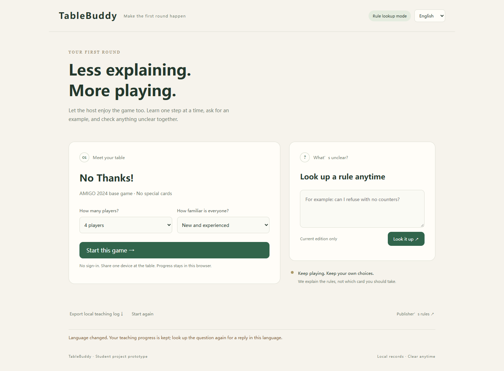
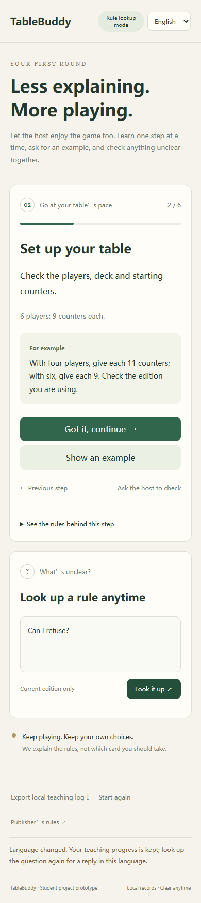

# 开局搭子 TableBuddy

**一起把第一局玩起来。 / Make the first round happen.**

[中文](#中文) · [English](#english)

## 中文

中文品牌名为**开局搭子**，英文名为 **TableBuddy**。网页版中文模式同时显示两者，英文模式仅显示TableBuddy。

开局搭子（TableBuddy）是一款面向青年桌游组局者的中英双语教学助手。它把新游戏拆成简短的教学步骤，让一桌人共用一台手机，按自己的节奏了解规则、查看例子、查询疑问，再回到桌边开始游戏。

项目优先关注中国大陆青年线下聚会的场景：组局者经常需要重复解释规则，新手一次听到太多内容又容易忘记。开局搭子尝试减少这部分负担，同时把现场判断和交流留给玩家。

本仓库保留两个可以独立运行的网页版：**原生版 v0.3.0** 与 **Vue版 v0.4.0**。当前为学生课程实践原型，已实现规则检索和可配置的模型接口，真实模型效果、真人使用效果和付费意愿仍待验证。


### 可以做什么

| 功能 | 说明 |
|---|---|
| 分步带新 | 按目标、准备、行动、回合交接、计分、首轮练习推进 |
| 根据经验调整 | 新手查看完整解释，熟手使用简版说明；准备提示按人数调整 |
| 按需举例与回看 | 举例不跳步，也可以返回上一步重新确认 |
| 人工确认 | 有争议时暂停教学，由组局者核对后继续 |
| 规则查询 | 检索当前版本的规则条目，附出处和出版商PDF页码链接 |
| 可选模型解释 | 配置服务端模型后请求解释，失败时回退到规则片段 |
| 中英切换 | 界面、教学、例子、规则片段和提示支持中文与英文 |
| 本机进度 | 保存未结束的教学，刷新后手动恢复；语言切换保留进度 |
| 日志导出 | 导出本机教学事件，便于复查操作过程 |

初期希望验证的收益方式包括组局者按场使用、桌游店带新辅助等，尚未实现在线支付，也没有已验证的收入数据。

<details>
<summary>查看手机尺寸教学界面</summary>

<p align="center">
  
</p>

手机图片来自浏览器尺寸模拟。

</details>

### 两个版本怎么选

| 对比项 | 原生网页版 | Vue网页版 |
|---|---|---|
| 版本 | v0.3.0 | v0.4.0 |
| 目录 | `桌游新手陪局Agent/网页实现/` | `桌游新手陪局Agent-Vue/网页实现/` |
| 前端 | HTML、CSS、JavaScript模块 | Vue 3单文件组件、Composition API、Vite |
| 界面更新 | JavaScript操作页面元素 | Vue模板和响应式状态 |
| 安装与编译 | 无需安装第三方npm运行依赖，无需编译 | 首次安装依赖，运行前编译 |
| 修改预览 | 修改后刷新页面 | 开发模式支持热更新 |
| 适合用途 | 学习网页基础、理解完整请求过程 | 继续增加功能、练习组件化开发 |

后续开发可从Vue版开始，原生版适合对照学习。两个版本分别保留自己的Node后端、规则包和教学逻辑，可以独立运行。它们通过目录指纹和版本区分服务，启动时会避让其他项目占用的端口。

浏览器进度按访问来源保存，换端口后不会自动继承另一版本的进度。两个版本也不共享多人会话。

### 快速开始

#### 环境

- 原生版：Node.js 22或以上版本。
- Vue版：Node.js 22.12或以上版本；首次安装依赖需要联网。
- 支持JavaScript模块的现代浏览器。

#### Windows双击启动

进入想运行的版本的 `网页实现` 文件夹，双击 `start-web.cmd`。

Vue启动器会检查依赖，必要时自动安装，再编译并打开网页。两个版本默认使用 `http://127.0.0.1:3186`，端口冲突时尝试后续端口，请以终端显示的 `Local` 地址为准。

保持服务窗口打开。结束时在该窗口按 `Ctrl+C`；若出现 `Terminate batch job (Y/N)?`，输入 `Y` 并回车。关闭浏览器不会停止服务或释放端口。

#### 命令行：原生版

在仓库根目录打开终端：

```powershell
cd "桌游新手陪局Agent/网页实现"
npm start
```

无需先执行 `npm install`。Windows下希望同时打开浏览器，可使用 `node server.mjs --open`。

#### 命令行：Vue版

在仓库根目录打开终端：

```powershell
cd "桌游新手陪局Agent-Vue/网页实现"
npm ci
npm start
```

`npm start` 先编译再启动；希望同时打开Windows浏览器时，使用 `npm start -- --open`。开发时运行：

```powershell
npm run dev
```

打开终端显示的开发地址，通常是 `http://127.0.0.1:5173`。修改 `.vue` 后页面自动更新，API请求通过开发代理转发到本地后端。`npm run build` 只生成 `dist/`，已构建的页面可用 `node server.mjs` 运行。

#### 同一Wi-Fi下使用手机

在所选版本的 `网页实现` 目录，将 `.env.example` 复制为 `.env`，设置：

```dotenv
HOST=0.0.0.0
PORT=3186
```

停止旧服务并重新启动，手机连接同一网络，访问电脑的实际局域网IP及运行端口，例如 `http://192.168.1.20:3186`。示例IP需自行替换；手机上的 `127.0.0.1` 指向手机自己。校园网隔离和防火墙可能影响连接，真机及微信内访问仍需验证。

### 模型配置与回答方式

没有密钥时，网页使用**规则检索模式**，展示匹配的规则片段，不调用外部模型。

需要模型解释时，在所选版本的 `网页实现/.env` 中配置自己的参数：

```dotenv
LLM_API_KEY=your_api_key_here
LLM_API_URL=https://api.deepseek.com/chat/completions
LLM_MODEL=your_available_model_name
LLM_TIMEOUT_MS=12000
```

修改后先停止旧服务再启动。接口适配器采用DeepSeek Chat Completions形式，更换提供方前应核对其官方接口。密钥只放在服务端，真实 `.env` 不应提交到Git仓库。

页面显示“模型已配置”只代表读到了配置。后端会检查游戏版本、问题长度、返回格式和引用ID；缺少依据、请求失败或引用不匹配时，保留规则片段并提示人工确认。有效的引用ID不保证解释正确，仍需对照规则核查。

### 系统如何协作



教学进度由明确的状态逻辑控制，模型不决定玩家是否完成教学。原生版使用页面事件和DOM更新；Vue版由 `App.vue` 组合6个界面组件，并使用 `composables/` 管理语言、教学和问答状态。

### 仓库导航

```text
.
├─ README.md                         两个版本的统一介绍
├─ 桌游新手陪局Agent/
│  ├─ 网页实现/                      原生网页版
│  ├─ 小程序初步实现/                早期小程序原型
│  └─ docs/images/                   界面截图
├─ 桌游新手陪局Agent-Vue/
│  ├─ 网页实现/
│  │  ├─ src/App.vue                 Vue页面总装
│  │  ├─ src/components/             6个界面组件
│  │  ├─ src/composables/            语言、教学和问答状态
│  │  ├─ src/game.mjs                规则、教学步骤与出处
│  │  ├─ src/core.mjs                教学状态与计分逻辑
│  │  ├─ src/assistant.mjs           服务端检索、模型适配与回退
│  │  ├─ scripts/                    编译启动与开发服务
│  │  ├─ tests/                      开发验证
│  │  └─ server.mjs                  资源与API服务
│  ├─ Vue重构说明.md                 重构说明及修改入口
│  └─ docs/images/                   Vue版截图
└─ 报告/                             阶段报告、项目大纲与协作说明
```

- [原生版详细说明](桌游新手陪局Agent/网页实现/README.md)
- [Vue版详细说明](桌游新手陪局Agent-Vue/网页实现/README.md)
- [Vue重构说明](桌游新手陪局Agent-Vue/Vue重构说明.md)
- [第5～6周架构与协作记录](报告/第5至6周_架构与协作记录.md)

### 验证与当前进展

最近一次保存的开发验证记录日期为 **2026年10月27日**：

| 检查 | 原生版 | Vue版 |
|---|---|---|
| 自动化检查 | 63项通过 | 68项通过 |
| 浏览器流程检查 | 19项通过 | 22项通过 |
| 额外启动流程检查 | — | 6项通过 |

原生版在其 `网页实现` 目录运行 `npm test`。Vue版在对应目录运行：

```powershell
npm test
npm run test:browser
npm run test:startup
```

Vue浏览器检查使用项目内的Playwright，优先寻找系统Chrome／Edge；没有可用浏览器时，先运行 `npx playwright install chromium`。原生版浏览器脚本保留了制作环境的绝对路径，换电脑运行前需要调整。

检查覆盖教学状态、版本约束、计分、双语、检索、模型契约、错误回退、HTTP服务和启动流程。其中32条检索题是构造的开发样例；模型测试采用模拟响应；手机布局检查为360、390、430像素宽度模拟。

尚未完成真实模型效果、手机真机、微信内浏览器、真人教学效果及付费验证。导出的JSON只记录本机教学事件，不是访谈记录、学习成绩或完整对局数据。当前没有账号、跨设备同步、在线支付或公开部署。

### 规则范围与后续计划

首个规则包为 **No Thanks!基础玩法**，依据[AMIGO 2024英文规则](https://blog.amigo-spiele.de/content/ap/rule/02455-GB-AmigoRule.pdf)整理，不含特效卡。中英内容均为项目教学摘要，使用前应核对实体游戏及规则版本。

后续将继续验证真实模型回答，开展手机与微信内访问测试，再组织新手局，记录教学耗时、重复解释、规则错误、操作负担和再次使用意愿，进而探索按场使用的付费可能。

项目发起人负责目标人群、使用场景和产品路线判断，并在调研后提出从小程序转向手机网页。AI参与架构、代码、规则整理和开发验证。阶段报告反映各阶段的实现；当前代码结构以对应版本说明为准。

## English

TableBuddy is a bilingual teaching assistant for young people who host board-game nights. It breaks a new game into short steps so a table can share one phone, review examples, look up questions and return to playing.

The initial focus is on young adults gathering in mainland China. Hosts often repeat explanations, while newcomers can struggle to remember a full introduction. TableBuddy aims to reduce that burden while keeping discussion and judgment at the table.

This repository contains two independently runnable web editions: **vanilla v0.3.0** and **Vue v0.4.0**. It is a student project prototype with rule retrieval and a configurable model adapter. Live model quality, effectiveness with real players and willingness to pay still need validation.



### Features

| Feature | Implementation |
|---|---|
| Guided teaching | Objective, setup, actions, turn handover, scoring and a practice round |
| Experience-aware explanations | Full or short descriptions, with setup guidance based on player count |
| Examples and review | Request an example without advancing, or return to the previous step |
| Host confirmation | Pause disputed steps and resume after the host checks |
| Rule lookup | Retrieve edition-specific excerpts with source IDs and publisher PDF page links |
| Optional model explanations | Use a server-configured model and fall back to excerpts on failure |
| Chinese and English | Localized interface, teaching steps, examples, excerpts and messages |
| Local progress | Restore an unfinished guide after a reload; language changes preserve progress |
| Event export | Download local teaching events for review |

Potential revenue experiments include per-session access for hosts and onboarding support for board-game venues. Payments and revenue have not been validated or implemented.

<details>
<summary>English mobile-size preview</summary>

<p align="center">
  
</p>

Mobile images are browser viewport simulations.

</details>

### Choose an edition

| Item | Vanilla web edition | Vue web edition |
|---|---|---|
| Version | v0.3.0 | v0.4.0 |
| Directory | `桌游新手陪局Agent/网页实现/` | `桌游新手陪局Agent-Vue/网页实现/` |
| Frontend | HTML, CSS and JavaScript modules | Vue 3 SFCs, Composition API and Vite |
| UI updates | DOM manipulation and event handlers | Templates and reactive state |
| Setup | No third-party npm runtime dependencies or build step | Dependency installation and frontend build |
| Editing | Refresh after changes | Hot updates in development mode |
| Useful for | Learning web fundamentals and request handling | Further development and component-based organization |

Use the Vue edition for further development and the vanilla edition for comparison. Each retains its own Node backend, rules and teaching logic. Folder fingerprints and versions distinguish running services; occupied ports trigger another port. Browser progress is origin-specific and does not automatically move between ports or editions. Neither edition shares multiplayer state.

### Quick start

Requirements: **Node.js 22+** for vanilla, or **Node.js 22.12+** for Vue, plus a modern browser. The Vue edition needs internet access for its initial dependency installation.

On Windows, open the chosen edition’s `网页实现` folder and double-click `start-web.cmd`. The Vue launcher checks dependencies and builds the frontend before opening the browser. The default URL is `http://127.0.0.1:3186`; use the printed Local URL if that port is occupied.

Keep the service terminal open. Stop with `Ctrl+C`, then enter `Y` if Windows asks to terminate the batch job. Closing the browser does not stop the backend or release its port.

#### Vanilla edition

From the repository root:

```powershell
cd "桌游新手陪局Agent/网页实现"
npm start
```

No `npm install` is required. Use `node server.mjs --open` to open the Windows browser as well.

#### Vue edition

From the repository root:

```powershell
cd "桌游新手陪局Agent-Vue/网页实现"
npm ci
npm start
```

`npm start` builds before serving. Use `npm start -- --open` to open the Windows browser. For hot updates while editing `.vue` files:

```powershell
npm run dev
```

Open the printed development URL, usually `http://127.0.0.1:5173`. API requests are proxied to the local Node backend. `npm run build` only produces `dist/`; after building, `node server.mjs` serves that output directly.

#### Phone on the same Wi-Fi

In the chosen edition’s `网页实现` directory, copy `.env.example` to `.env`, set `HOST=0.0.0.0` and optionally `PORT=3186`, then stop the old service and restart. Use the computer’s actual LAN IP and active port on the phone, such as `http://192.168.1.20:3186`. Replace the example IP. `127.0.0.1` on a phone refers to the phone itself. Firewall rules or campus-network isolation may prevent access; physical-phone and WeChat testing remain pending.

### Model configuration and architecture

Without credentials, **Rule lookup mode** returns matching excerpts without calling an external model. For optional model explanations, configure the selected edition’s server-side `网页实现/.env`:

```dotenv
LLM_API_KEY=your_api_key_here
LLM_API_URL=https://api.deepseek.com/chat/completions
LLM_MODEL=your_available_model_name
LLM_TIMEOUT_MS=12000
```

Restart the old service after changes. The adapter follows the DeepSeek Chat Completions format; check the selected provider’s official API before changing services. Keep credentials server-side and exclude real `.env` files from Git.

“Model configured” means configuration was found, not that live behavior has been verified. The backend validates game versions, question length, output structure and source IDs. Missing evidence, request failures and invalid citations lead to excerpts and host confirmation. Valid source IDs do not guarantee a correct explanation.

Both editions follow the architecture shown above: browser teaching state and local progress, a Node question endpoint, edition-specific retrieval, optional server-side model calls, and output validation or fallback. Explicit state logic controls teaching progress. The Vue edition composes six UI components in `App.vue`, with composables for locale, teaching/storage and requests.

### Repository guide

| Path | Contents |
|---|---|
| `桌游新手陪局Agent/网页实现/` | Vanilla frontend, Node API and tests |
| `桌游新手陪局Agent-Vue/网页实现/` | Vue frontend, Node API, build/start scripts and tests |
| `桌游新手陪局Agent-Vue/网页实现/src/components/` | Header, setup, lesson, completion, rule lookup and source lists |
| `桌游新手陪局Agent-Vue/网页实现/src/composables/` | Locale, teaching/storage and cancellable request state |
| Each edition’s `src/game.mjs` and `src/core.mjs` | Rules, teaching steps, state transitions and scoring |
| Each edition’s `src/assistant.mjs` | Server-side retrieval, model adapter and fallback |
| Each edition’s `docs/images/` | Screenshots |
| `小程序初步实现/` within each edition | Historical Mini Program prototype |
| `报告/` | Milestone reports, planning and collaboration records |

Implementation details: [vanilla guide](桌游新手陪局Agent/网页实现/README.md#english), [Vue guide](桌游新手陪局Agent-Vue/网页实现/README.md#english), and [Vue migration guide](桌游新手陪局Agent-Vue/Vue重构说明.md#english).

### Validation and status

The latest saved development records are dated **27 October 2026**:

| Check | Vanilla | Vue |
|---|---|---|
| Automated checks | 63 passed | 68 passed |
| Browser-flow checks | 19 passed | 22 passed |
| Additional launcher checks | — | 6 passed |

Run `npm test` in the relevant web directory. The Vue edition also provides `npm run test:browser` and `npm run test:startup`. Its browser checks use the local Playwright dependency and installed Chrome/Edge; run `npx playwright install chromium` if no suitable browser is available. The vanilla browser script retains authoring-machine paths that need adjustment on another computer.

Coverage includes state, versions, scoring, localization, retrieval, model contracts, fallbacks, HTTP handling and startup behavior. The 32 retrieval questions are constructed development examples. Model responses are mocked; mobile layouts are tested at simulated widths of 360, 390 and 430 pixels.

Live models, physical phones, WeChat browsing, real-player learning outcomes and payment remain unvalidated. Exported JSON contains local teaching events, not interviews, learning scores or complete game histories. Accounts, cross-device synchronization, payments and public hosting are not implemented.

### Rules and next steps

The first rules package is **No Thanks!, base game**, summarized from [AMIGO’s 2024 English rules](https://blog.amigo-spiele.de/content/ap/rule/02455-GB-AmigoRule.pdf), excluding special cards. Both languages are project teaching summaries. Verify the physical game and edition before use.

Next steps are live model evaluation, phone and WeChat testing, then real newcomer sessions measuring teaching time, repeated explanations, rule mistakes, interaction burden and reuse intent, followed by payment experiments.

The project initiator defines the audience, scenarios and product direction, and proposed the mobile-web approach after research. AI contributes architecture, implementation, rule organization and development checks. Historical reports describe their own milestones; consult each edition’s documentation for its current structure.
