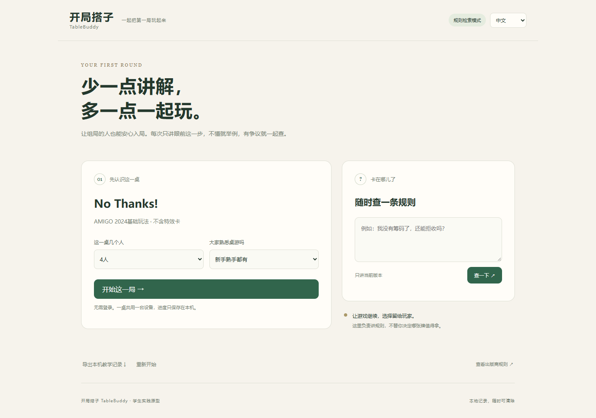
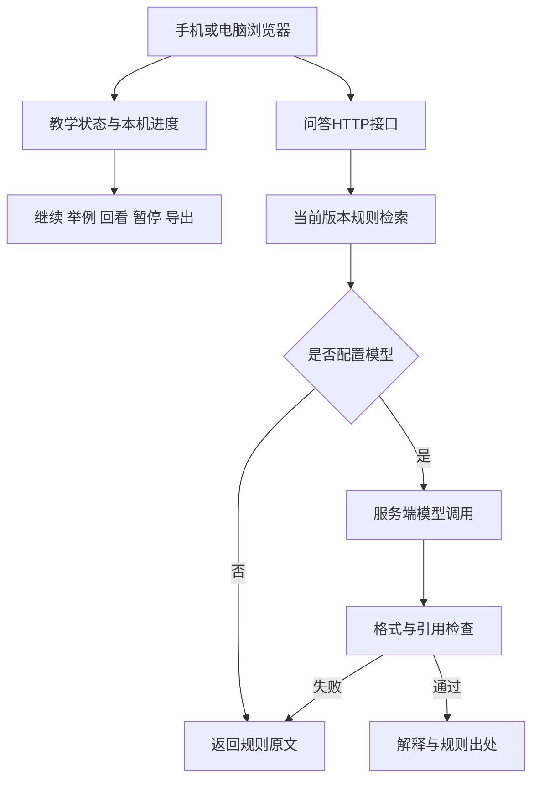
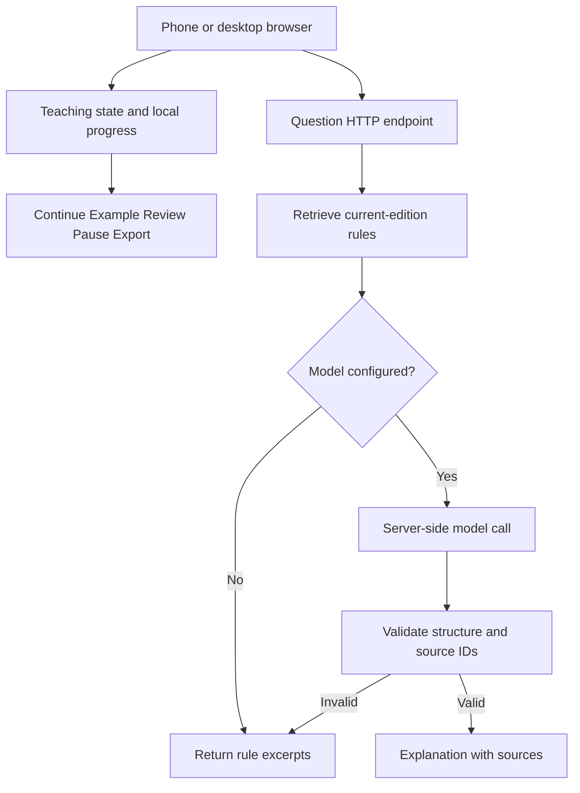

# 开局搭子 TableBuddy

[中文](#中文) · [English](#english)

## 中文

中文品牌名为**开局搭子**，英文名为 **TableBuddy**。网页版中文模式同时显示两者，英文模式仅显示TableBuddy。

面向青年桌游组局者的手机网页带新助手。

开局搭子（TableBuddy）把新游戏的学习过程拆成简短的教学步骤，支持按需举例、回看、规则查询和人工确认，帮助组局者带新人完成第一轮游戏。项目优先关注中国大陆青年线下聚会的使用场景，以一桌共用一台设备的方式降低操作负担。

当前为课程实践原型，版本号见[package.json](web/package.json)。已完成中英双语手机网页、教学状态管理、规则检索后端和可配置的模型接口；尚未公开部署，真实模型联调及真人使用效果仍待验证。



### 项目目标

- 帮助新手从了解目标、准备游戏到尝试合法行动，逐步学会第一局。
- 减少组局者的重复解释，同时保留人与人交流和判断的空间。
- 通过真实试用，比较教学耗时、规则错误、操作负担与再次使用意愿，并探索按场付费的可能性。

项目的技术路线根据前期调研，从微信小程序调整为手机适配网页，以便开展现场试用和快速修改。早期小程序探索作为项目背景保留，当前仓库提供两个网页版。

### 主要功能

| 功能 | 当前实现 |
|---|---|
| 中英切换 | 顶部选择中文或English，教学进度与已展开例子保留；记住本机语言偏好 |
| 分步教学 | 依次介绍目标、准备、行动、回合交接、计分和首轮练习 |
| 按经验调整说明 | 新手使用完整解释，熟手使用简版说明 |
| 教学反馈 | 支持举例、回看、暂停，组局者确认后继续 |
| 规则检索 | 根据问题检索当前版本的规则条目，并显示出处及PDF页码 |
| 可选模型解释 | 配置服务端模型后请求解释；异常时回退到规则原文 |
| 本机进度 | 保存未结束的教学进度，刷新后可恢复 |
| 记录导出 | 导出本机教学事件，便于复查操作过程 |
| 启动处理 | 同项目服务复用，端口冲突时自动尝试后续端口 |

<details>
<summary>查看手机尺寸界面</summary>

<p align="center">
  
</p>

</details>

### 快速开始

#### 环境要求

- Node.js **22或以上版本**。
- 支持JavaScript模块的现代浏览器。
- 当前运行时不依赖第三方npm包，无需先执行 `npm install`。

#### Windows启动

进入 `web` 文件夹，双击：

```text
start-web.cmd
```

服务准备好后会自动打开浏览器。默认访问地址为：

```text
http://127.0.0.1:3186
```

如果该端口已被其他程序占用，启动器会尝试后续端口，请以窗口显示的 `Local` 地址为准。服务运行期间保持命令窗口打开；关闭网页不会停止后端，在服务窗口按 `Ctrl+C` 可以停止服务。出现 `Terminate batch job (Y/N)?` 时，输入 `Y` 并回车。

启动脚本使用系统安装的Node。安装Node后，也可以使用下面的命令。

#### 命令行启动

在仓库根目录执行：

```powershell
cd "web"
npm start
```

希望同时自动打开系统浏览器时，可执行：

```powershell
node server.mjs --open
```

#### 手机访问

默认服务只允许本机访问。同一Wi-Fi下使用手机测试时，在 `web` 目录把 `.env.example` 复制为 `.env`，设置：

```dotenv
HOST=0.0.0.0
PORT=3186
```

重启服务后，用手机访问电脑的局域网IP和实际端口，例如 `http://192.168.1.20:3186`。请将示例IP替换为电脑的实际地址。校园网设备隔离或防火墙设置可能影响连接。

### 模型配置与运行模式

默认情况下，项目可以在没有模型密钥的环境下运行，页面显示 **规则检索模式**。该模式返回匹配的规则条目，不生成模型解释。

如需模型解释，在 `web/.env` 中配置自己的服务端参数：

```dotenv
LLM_API_KEY=your_api_key_here
LLM_API_URL=https://api.deepseek.com/chat/completions
LLM_MODEL=your_available_model_name
LLM_TIMEOUT_MS=12000
```

密钥和模型名称需要自行替换；修改配置后，先停止旧服务再启动。适配器参考DeepSeek Chat Completions接口实现，接入其他服务前应核对其官方接口要求。

后端会检查问题长度、游戏版本、模型返回格式与引用ID。没有依据、模型不可用或引用不匹配时，会保留规则原文并提示人工确认。**引用ID有效不等于解释一定正确，仍需核对规则。**

真实 `.env` 不应提交到Git仓库；仓库仅保留不含密钥的 `.env.example`。

### 系统结构



前端采用HTML、CSS和JavaScript，后端采用Node.js原生HTTP模块。教学进度由明确的状态数据维护，模型不直接决定玩家是否完成教学。

### 仓库目录

```text
.
├─ README.md                  项目介绍与快速开始
├─ docs/images/               GitHub首页展示图片
├─ web/                  当前主要开发版本
│  ├─ public/                 页面、样式与浏览器交互
│  ├─ src/
│  │  ├─ game.mjs             游戏规则、教学步骤与出处
│  │  ├─ core.mjs             教学状态与计分逻辑
│  │  └─ assistant.mjs        规则检索、模型适配与回退
│  ├─ tests/                  自动化测试和浏览器检查脚本
│  ├─ server.mjs              网页与API服务
│  ├─ start-web.cmd           Windows启动入口
│  └─ .env.example            配置示例
└─ references/                  课程要求等材料
```

详细配置与实现说明见[网页版说明](web/README.md)。课程报告和协作记录仅在本地保留，不上传至仓库。

### 规则与内容范围

首个候选规则包为 **No Thanks! 基础玩法**，依据[AMIGO 2024英文规则](https://blog.amigo-spiele.de/content/ap/rule/02455-GB-AmigoRule.pdf)整理，不包含特效卡。页面中英文说明均为本项目的简要教学整理，不代替官方规则。线下使用前，应与实际持有的游戏及规则版本核对。

项目提供教学和规则查询，不模拟完整棋盘、不记录全部玩家行动，也不替玩家作策略决定。

### 验证与当前进展

版本号以各网页版的 `package.json` 为准；服务端状态接口从该文件读取版本。检查数量、通过情况与执行日期以本次命令输出和生成的报告为准。

在所选版本的 `web` 目录执行：

```powershell
npm ci
npm test
npm run test:browser
```

Vue版另提供 `npm run test:startup`，覆盖生产启动、重复启动、端口避让、开发代理及直接运行Vite。两个版本都使用项目内的Playwright；没有可用浏览器时，先运行 `npx playwright install chromium`。可用 `TABLEBUDDY_CHROME` 指定浏览器程序。

浏览器结果保存在 `web/test-results/browser-check/`，启动结果保存在 `web/test-results/startup-check/`，均由Git忽略。`TABLEBUDDY_EVIDENCE_DIR` 可覆盖结果根目录；脚本会在其下分别建立 `browser-check/` 和 `startup-check/`。生成报告记录本次执行时间。

检查覆盖教学状态、参数错误、双语提示、问答日志、重置、规则数据、限流、静态缓存和HTTP接口。模型分支使用可控模拟响应，手机布局使用浏览器尺寸模拟；真实模型、手机真机、微信内访问与真人使用效果列入后续验证。

日志覆盖开局前查询及当前教学过程，包含暂停和结束后的查询事件；导出JSON的 `setupEvents` 保存开局前事件，`session.logs` 保存教学会话事件，`phase` 标记查询阶段。重置会同时清除这些记录、问题输入和进行中的查询。

本地API支持curl等命令行工具省略Origin头。浏览器跨站来源会被拒绝；Origin校验用于浏览器来源限制。公网部署时应在网关配置身份认证和访问配额。

### 后续计划

1. 完成真实模型联调，增加不同问法与复杂规则问题的检查。
2. 核对实体游戏版本，进行手机及微信内访问测试。
3. 组织真实新手局，记录教学耗时、重复解释、规则错误和操作负担。
4. 根据反馈修订流程，再验证组局者的再次使用与按场付费意愿。

目前没有账号系统、多人同步、在线支付或公开部署功能。GitHub用于管理和展示源码；上传仓库不会自动启动本项目的Node后端。

### 实践与协作

项目发起人负责使用场景、目标人群和产品路线的判断，调研后提出从小程序转向手机适配网页。AI参与架构设计、代码生成与调整、规则整理和自动化检查。真人访谈、现场试玩和实际付费验证需要独立收集证据，不以代码测试替代。

### references

- [Node.js HTTP文档](https://nodejs.org/api/http.html)
- [DeepSeek Chat Completions接口](https://api-docs.deepseek.com/api/create-chat-completion/)
- [MDN localStorage](https://developer.mozilla.org/en-US/docs/Web/API/Window/localStorage)

## English

TableBuddy is a mobile-friendly board-game teaching assistant for young people who host game nights.

It breaks the first game into short teaching steps, with optional examples, previous-step review, rule lookup and host confirmation. The initial focus is on young adults playing together in mainland China, sharing one device at the table.

**Student project prototype.** See [package.json](web/package.json) for the current version. A bilingual web interface, teaching-state management, rule-retrieval backend and configurable model adapter are implemented. The project has not been publicly deployed; live model integration and effectiveness with real players still need validation.


### Goals

- Help new players move from understanding the objective and setup to trying a legal action.
- Reduce repeated explanations for the host while keeping discussion and judgment at the table.
- Evaluate teaching time, rule mistakes, interaction burden and reuse intent through real sessions, and explore payment per session.

Following the project initiator’s research, the implementation shifted from a WeChat Mini Program to a mobile-friendly website for easier field testing and iteration. This repository contains the two web editions; the earlier Mini Program work is historical context.

### Features

| Feature | Current implementation |
|---|---|
| Chinese and English | Switch languages in the header without losing the teaching step or expanded example; remember the preference in this browser |
| Guided teaching | Objective, setup, actions, turn handover, scoring and a practice round |
| Experience-aware text | Full explanations for new players and shorter text for experienced players |
| Teaching feedback | Examples, previous-step review, pause and host-confirmed resume |
| Rule lookup | Retrieve rule excerpts for the selected edition, with source IDs and PDF page links |
| Optional model explanations | Call a server-configured model; fall back to rule excerpts when unavailable |
| Local progress | Save an unfinished guide and restore it after reloading |
| Event export | Export local teaching events for review |
| Startup handling | Reuse a matching running service, or try another port when necessary |

Chinese and English questions can be entered in either interface language. Returned excerpts and guidance follow the selected interface language. Changing language clears a previous answer so the question can be submitted again; it does not reset teaching progress. When a model is configured, its prompt requests the selected output language, but the actual reply still needs validation.

<details>
<summary>English mobile-size preview</summary>

<p align="center">
  
</p>

</details>

### Quick start

Requirements: **Node.js 22 or later** and a modern browser with JavaScript module support. The current runtime has no third-party npm dependencies, so `npm install` is not required.

On Windows, open the `web` folder and double-click `start-web.cmd`. The browser opens after the service is ready. The default address is:

```text
http://127.0.0.1:3186
```

If the port is occupied, the launcher tries later ports. Use the actual `Local` address printed in the window. Keep the service window open. Closing the browser does not stop the backend; press `Ctrl+C` in the service window to stop it. If Windows asks `Terminate batch job (Y/N)?`, type `Y` and press Enter.

The Windows launcher uses the system Node installation. From the repository root, run:

```powershell
cd "web"
npm start
```

To also open the system browser automatically:

```powershell
node server.mjs --open
```

For a phone on the same Wi-Fi network, copy `web/.env.example` to `web/.env`, set `HOST=0.0.0.0`, and restart the old service. Open the computer’s actual LAN IP and active port on the phone, for example `http://192.168.1.20:3186`. Replace this example IP with your computer’s address. Campus-network isolation and firewall rules may prevent the connection. `127.0.0.1` on a phone refers to the phone itself, not your computer.

### Model setup and operating modes

Without model credentials, the website runs in **Rule lookup mode**. It returns matching excerpts without generating a model explanation.

For optional model explanations, configure your own server-side values in `web/.env`:

```dotenv
LLM_API_KEY=your_api_key_here
LLM_API_URL=https://api.deepseek.com/chat/completions
LLM_MODEL=your_available_model_name
LLM_TIMEOUT_MS=12000
```

Replace the placeholders with your own credentials and an available model name. Stop the old service before restarting after configuration changes. The adapter follows DeepSeek’s Chat Completions interface; check the provider’s official documentation before using another service.

The backend checks question length, game version, output structure and source IDs. Missing evidence, model failures or invalid citations trigger a fallback to excerpts and host confirmation. **A valid source ID does not guarantee that the explanation is correct.**

Never commit your real `.env`. The repository keeps only `.env.example`, without working credentials.

### Architecture



The frontend uses HTML, CSS and JavaScript. The backend uses Node.js’s native HTTP module. Explicit state data controls teaching progress; the model does not decide whether players have completed the guide. UI text is centralized in `public/i18n.mjs`.

### Repository guide

| Path | Purpose |
|---|---|
| `README.md` | Bilingual project overview and quick start |
| `docs/images/` | Screenshots displayed on the repository homepage |
| `web/public/` | Responsive UI, translations, browser interaction and local storage |
| `web/src/game.mjs` | Versioned rules, teaching steps and their Chinese/English descriptions |
| `web/src/core.mjs` | Teaching state and scoring logic |
| `web/src/assistant.mjs` | Rule retrieval, model adapter and fallbacks |
| `web/server.mjs` | Web assets and API service |
| `web/tests/` | Logic, HTTP, localization and browser checks |
| `references/` | Course requirements and supporting materials |

See the [web implementation guide](web/README.md) for implementation details. Course reports and collaboration records are kept locally and excluded from the repository.

### Game and content scope

The first candidate rules package is **No Thanks!, base game**, based on [AMIGO’s 2024 English rules](https://blog.amigo-spiele.de/content/ap/rule/02455-GB-AmigoRule.pdf). Special cards are excluded. Both language versions are concise teaching summaries prepared for this project, not replacements for the official rulebook. Check the edition of the physical game before using the guide.

The project teaches and looks up rules. It does not simulate the whole game, record every player’s move or choose strategies for players.

### Validation and current status

Each web project's `package.json` is the version source; the server derives its status version from it. Test totals, results and execution dates come from the current run and generated reports.

From the selected edition's `web` directory:

```powershell
npm ci
npm test
npm run test:browser
```

The Vue edition also provides `npm run test:startup`, covering production startup, reuse, occupied ports, the development proxy and direct Vite invocation. Both browser suites use project-local Playwright. Run `npx playwright install chromium` if no suitable browser is installed, or set `TABLEBUDDY_CHROME` to a browser executable.

Browser evidence is written to `web/test-results/browser-check/`, and startup evidence to `web/test-results/startup-check/`. Both are ignored by Git. `TABLEBUDDY_EVIDENCE_DIR` overrides the output base; scripts create separate `browser-check/` and `startup-check/` subdirectories. Reports record their actual execution time.

Checks cover state, invalid inputs, localized feedback, question logs, reset, rule data, rolling rate limits, asset caching and HTTP behavior. Model responses are mocked and mobile layouts use viewport simulation; live models, physical phones, WeChat and real-player outcomes remain evaluation tasks.

Exports include setup queries in `setupEvents` and teaching-session events in `session.logs`, including paused and completed-session queries. Query events carry a `phase` field. Reset clears these records, the typed question and any pending request.

Local command-line clients may omit Origin. Browser cross-site requests are rejected; Origin checks restrict browser sources. Public deployments should configure authentication and access quotas at the gateway.

### Next steps

1. Connect and evaluate a real model, including varied phrasings and more complex questions.
2. Verify the physical game edition and test phones and WeChat’s in-app browser.
3. Run real newcomer sessions and record teaching time, repeated explanations, rule mistakes and interaction burden.
4. Refine the guide and test hosts’ willingness to reuse or pay per session.

Accounts, cross-device synchronization, online payments and public deployment are not implemented. GitHub hosts the repository; pushing this code does not automatically run its Node backend.

### Practice and collaboration

The project initiator defines the audience and product direction and proposed the mobile-web route after research. AI contributes architecture proposals, code generation and revisions, rule organization and automated checks. Interviews, field sessions and payment validation require their own real-world evidence.

### References

- [Node.js HTTP documentation](https://nodejs.org/api/http.html)
- [DeepSeek Chat Completions API](https://api-docs.deepseek.com/api/create-chat-completion/)
- [MDN localStorage](https://developer.mozilla.org/en-US/docs/Web/API/Window/localStorage)
